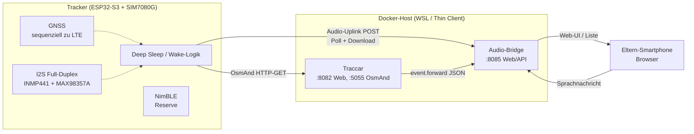
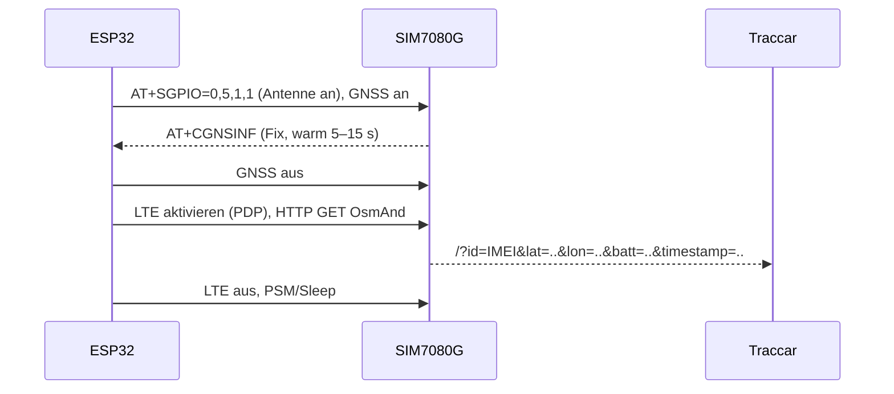

# Systemarchitektur & Datenflüsse

Ergänzt `project.md` (Überblick). Hier stehen die technischen Details für Firmware
und Server. Verbindliche Pins: `docs/pinout.md`.

## 1. Gesamtbild



## 2. Firmware

> **Toolchain-Hinweis:** Mit PlatformIO `espressif32@6.13.0` (Arduino-Core 2.x)
> steht der neue Full-Duplex-I2S-Treiber noch nicht bereit – dann den
> Legacy-Treiber nutzen oder auf Arduino-Core 3.x (pioarduino-Fork) wechseln.

### 2.1 Zustandsmaschine (Kern)

| Zustand | Auslöser | Ablauf |
|---|---|---|
| `SLEEP` | – | Deep Sleep, LIS3DH aktiv (~2 µA), Mikrofon aus, Verstärker SD=LOW |
| `MOTION` | LIS3DH INT1 (IO14) | GNSS-Fix → LTE-Upload → Poll (Nachricht?) → `SLEEP` |
| `PTT` | Taster (IO9) | Quittungston → 8 kHz-Aufnahme (max. 10 s) → Doppelton → Upload → `SLEEP` |
| `TIMER` | RTC-Timer | Poll (Nachricht? Suchmodus?) → ggf. Position → `SLEEP` |
| `SEARCH` | Suchmodus aktiv | Poll alle 30–60 s, Piezo-Intervallton, häufigere Positionen |
| `PLAYBACK` | Nachricht vorhanden | Download → ADPCM-Decode → Wiedergabe → Verstärker aus → `SLEEP` |

### 2.2 Sequenz Ortungs-Push (GNSS und LTE exklusiv!)



### 2.3 Audio-Uplink (Kind → Eltern)

Rohformat: **IMA-ADPCM, 8 kHz, mono, in WAV** (Header von der Firmware erzeugt).
10 s ≈ 40 kB. Die Bridge wandelt für den Browser nach Opus/MP3 (ffmpeg).

### 2.4 Audio-Downlink (Eltern → Kind)

Browser nimmt Opus/WebM auf → Bridge konvertiert nach IMA-ADPCM-WAV (8 kHz, mono)
→ Tracker lädt beim Poll herunter und spielt ab.

## 3. Audio-Bridge (FastAPI)

### 3.1 Datenmodell (SQLite)

```
messages(id TEXT PK, direction TEXT CHECK(in|out), device_id TEXT,
         created_at TEXT, status TEXT, raw_file TEXT, device_file TEXT,
         duration_ms INTEGER, note TEXT)
```

Status-Werte: `new` → `delivered` (Downlink) bzw. `new` → `read` (Uplink, optional).
Dateien liegen unter `DATA_DIR/audio/<id>.<ext>`.

Weitere Tabellen: `devices` (Registry: id=IMEI, name, msisdn, notes),
`findmy_locations` (provider, beacon_id, lat/lon, accuracy, reported_at, raw) und
`positions` (Tracker-Positionen inkl. Akkustand für das Status-Dashboard).

### 3.2 Endpunkte

| Methode | Pfad | Auth | Zweck |
|---|---|---|---|
| GET | `/healthz` | – | Healthcheck |
| GET | `/` | – | Eltern-Web-UI (Status, Recorder, Geräte, Liste) |
| POST | `/api/v1/device/sync` | Device-Token | **Kombinierter Sync** (A5): Position rein; Nachricht, `next_poll_s`, Suchmodus raus |
| POST | `/api/v1/device/messages` | Device-Token | Audio-Uplink des Trackers |
| GET | `/api/v1/device/pending` | Device-Token | Kompatibilitäts-Endpunkt (ältere Firmware) |
| GET | `/api/v1/device/messages/{id}/audio` | Device-Token | Downlink-Datei, markiert als zugestellt |
| POST | `/api/v1/parent/messages` | Parent-Token | Sprachnachricht der Eltern |
| GET | `/api/v1/parent/messages` | Parent-Token | Liste (JSON) |
| GET | `/api/v1/parent/status` | Parent-Token | Status-Dashboard (Position, Akku, Nachrichten, Poll) |
| POST | `/api/v1/parent/search-mode` | Parent-Token | Suchmodus setzen/beenden |
| POST | `/api/v1/parent/maintenance/cleanup` | Parent-Token | Retention manuell auslösen |
| GET | `/api/v1/parent/devices` | Parent-Token | Geräte-Registry (IMEI ↔ MSISDN ↔ Name) |
| PUT | `/api/v1/parent/devices/{id}` | Parent-Token | Gerät anlegen/ändern |
| DELETE | `/api/v1/parent/devices/{id}` | Parent-Token | Gerät löschen |
| POST | `/api/v1/findmy/locations` | optional Token | Find-My-Ingest (Apple/Google, tolerant) |
| GET | `/api/v1/parent/findmy/locations` | Parent-Token | letzte Find-My-Positionen |
| POST | `/api/v1/traccar/events` | optional Token | Webhook-Empfänger (Traccar) |

### 3.3 Suchmodus

`search-mode` ist ein einfacher Schalter (Datei/DB-Flag mit Ablaufzeit, z. B. 30 min).
`/pending` liefert ihn mit; der Tracker verkürzt daraufhin sein Poll-Intervall.

### 3.4 Geräte-Identitäten (IMEI, MSISDN, Beacon-IDs)

- **Primär-ID des Trackers = IMEI** (per `AT+GSN`): identisch in Traccar (OsmAnd `id=`)
  und in der Bridge (`device_id`).
- **MSISDN** (1NCE-Rufnummer) wird in der Registry mitgeführt – für den optionalen
  SMS-Pfad (`docs/sms.md`).
- **Beacon-IDs** (Apple/Google) sind eigene Geräte für Find-My-Positionen.
- Unbekannte Geräte legt die Bridge automatisch an (analog Traccar
  `database.registerUnknown`); Pflege über die Eltern-UI/API.

### 3.5 Find My (optional, Profil `findmy`)

Externe Gegenstücke pushen Standorte an `/api/v1/findmy/locations` (tolerantes
Schema, Roh-JSON wird mitgespeichert). Bei gesetztem `TRACCAR_FORWARD_URL` wird
jede Position als OsmAnd-Position an Traccar gereicht (eigenes Gerät je Beacon).
Setup und Grenzen: `docs/findmy.md`.

## 4. Traccar

- Nimmt OsmAnd-GETs entgegen, `database.registerUnknown=true` (Auto-Registrierung).
- `event.forward.url` → `http://audio-bridge:8085/api/v1/traccar/events`
  (Geofence/Alarm/Status-Ereignisse landen in der Bridge).
- Karte/Geofence/Akkustand sind die Eltern-Sicht für Positionen; Audio läuft
  vollständig über die Bridge-UI.

## 5. Energiebudget (Schätzung)

| Zustand | Strom/Energie | Menge/Tag | mAh/Tag |
|---|---|---|---|
| Deep Sleep (Board + LIS3DH) | 0,4–1,1 mA | 24 h | 9–26 |
| Modem eDRX registriert (optional) | ~0,6 mA | 24 h | ~14 |
| Ortungszyklus | ~1–2 mAh | 20 | 20–40 |
| Audio-Nachricht | ~1,5–2 mAh | 5 | 8–10 |
| Server-Poll (15 min) | ~0,5–1 mAh | 96 | 50–96 |
| **Summe realistisch** | | | **~100–180 mAh/Tag** |

⇒ 2.000-mAh-Akku: **~11–20 Tage** im Dauerbetrieb mit 15-min-Poll; ohne Poll
(deutlich seltener) entsprechend länger. Suchmodus (5-min-Poll) verkürzt die
Laufzeit auf wenige Tage – daher automatisch zeitlich begrenzen.

## 6. Fehlerfälle

| Fall | Verhalten |
|---|---|
| Kein GNSS-Fix | letzte bekannte Position + `hdop`-Flag senden; kein Retry im selben Wake |
| Kein Netz | Position puffern (kleiner Ringpuffer in RTC-RAM/NVS), beim nächsten Wake senden |
| Upload fehlgeschlagen | Datei behalten, beim nächsten Wake erneut versuchen |
| Akku < 15 % | Poll-Intervall erhöhen, Audio-Uplink erlauben, Downlink-Wiedergabe begrenzen |
| Bridge nicht erreichbar | Tracker bleibt im normalen Zyklus, kein Dauer-Retry |
